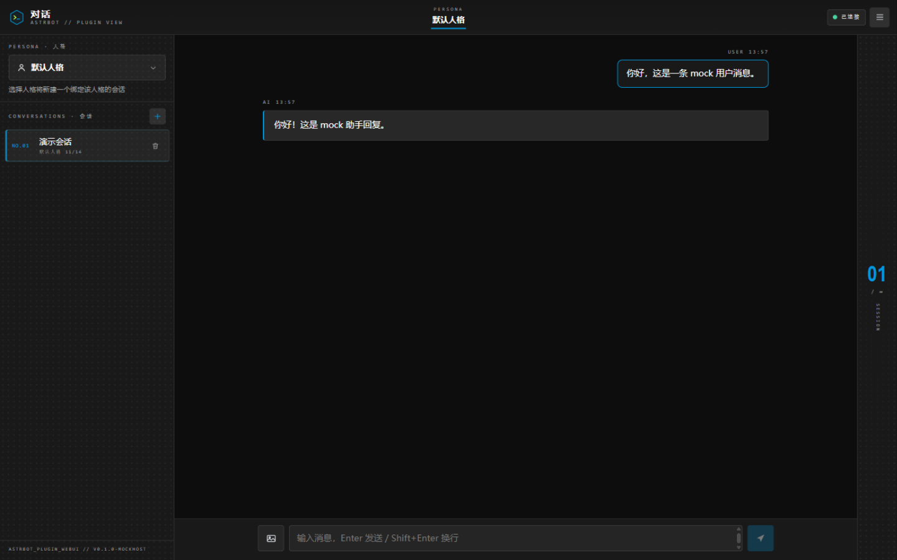

<div align="center">

# 🍹 酒馆风对话 WebUI

**astrbot_plugin_webui** —— 给 AstrBot 加一个「类 SillyTavern（酒馆）」的网页聊天界面

深色酒馆风视觉 · 打字机式流式回复 · 思考过程 / 工具调用实时展示 · 支持图片与文件附件




</div>

---

## ✨ 它能做什么

| | 功能 | 一句话说明 |
|---|---|---|
| 💬 | **选人格聊天** | 界面里直接切换 AstrBot 已配置的人格，每人格一个会话，无需敲指令 |
| ⚡ | **真·流式回复** | 回复像打字机一样逐字蹦出；断线、刷新页面后自动接上，不丢内容 |
| 🧠 | **思考过程展示** | 推理模型（如 DeepSeek-R1 类）的思考内容实时显示，完成后自动折叠 |
| 🔧 | **工具调用可视化** | 模型调工具时实时显示「工具名 → 参数 → 结果」，像看它干活一样 |
| 📎 | **图片 + 文件附件** | 直接拖图/选文件随消息发送（图片自动压缩，文本文件内容喂给模型） |
| 🖥️ | **两种打开方式** | 从 AstrBot 管理面板直接打开，或用独立网址 `http://127.0.0.1:6186` 访问 |
| 🗂️ | **会话管理** | 新建 / 切换 / 删除会话，历史完整保留（含思考、工具步骤、附件） |
| 🎨 | **明日方舟风格 UI** | 深色 + 青色主视觉（参考明日方舟官网设计语言），支持中英文界面 |

> 所有会话在两个入口之间**实时共享**——面板里聊到一半，换个浏览器接着聊也行。

## 🤔 和 AstrBot 自带的网页聊天有什么区别？

| | 内置 WebChat | 本插件 |
|---|---|---|
| 回复方式 | 整段出现 | **逐字流式** |
| 思考过程 | 看不到 | **实时展示 + 历史可回看** |
| 工具调用 | 简单提示 | **参数/结果折叠块全程可视化** |
| 界面风格 | 管理面板风 | 酒馆风沉浸式 |
| 记忆类插件 | ✅ 生效 | ❌ 不生效（见下方说明） |
| 会话空间 | 官方会话 | 独立会话空间，互不干扰 |

**为什么记忆类插件不生效？** 本插件为了拿到「逐字流式」直接调用模型接口，不经过
AstrBot 的消息处理管道——长记忆、人格增强这类依赖管道的插件在本界面的对话中
不会触发。这是拿真流式的代价，二者可以并存按需选用。**AstrBot 管理面板不受
本插件任何影响。**

## 📦 安装

**要求**：AstrBot ≥ 4.29、Python ≥ 3.12。**无需任何额外 pip 依赖**。

- **方式一 · 本地上传（推荐）**：到 [Releases](https://github.com/AiE1487/astrbot_plugin_webUI/releases)
  下载 `astrbot_plugin_webui-vX.Y.Z.zip` → AstrBot 管理面板 → 插件管理 →
  安装插件 → 从本地上传；
- **方式二 · 手动解压**：把 zip 解压到 `AstrBot/data/plugins/astrbot_plugin_webui/`
  （保证该目录下直接是 `main.py`、`metadata.yaml`），然后在插件管理里重载插件；
- **方式三 · git clone**：

  ```bash
  cd AstrBot/data/plugins
  git clone https://github.com/AiE1487/astrbot_plugin_webUI.git astrbot_plugin_webui
  ```

  然后在插件管理里重载插件。

> ⚠ 目录名必须是 `astrbot_plugin_webui`（全小写）。

## 🚀 快速开始

### 方式一：管理面板内嵌打开（最简单）

装好插件后，AstrBot 管理面板 → **插件管理 → 本插件 → 打开「对话」视图**。
复用面板登录状态，无需再登录。

### 方式二：独立网址访问

浏览器打开 **`http://127.0.0.1:6186/`**（默认开启）。

- **没设密码**：只允许本机（127.0.0.1）访问，局域网其他设备会提示无权限；
- **想局域网/远程访问**：在插件配置里设置 `standalone_password`，重载插件后
  在登录卡输入密码即可；连续输错 5 次会锁定 60 秒；
- 端口被占用时改配置里的 `standalone_port`。

两个入口共用同一套会话数据，可同时使用。

## ⚙️ 配置项

在 AstrBot 管理面板 → 插件管理 → 本插件 → 配置 中修改。
带 ⚑ 的项**修改后需重载插件**才生效，其余即时生效。

| 键 | 类型 | 默认值 | 说明 |
|----|------|--------|------|
| `standalone_enabled` ⚑ | bool | `true` | 启用独立端口页；关闭后只能从管理面板进入 |
| `standalone_port` ⚑ | int | `6186` | 独立端口监听端口，冲突时可改 |
| `standalone_password` ⚑ | string | 空 | 独立端口密码；空 = 仅本机 127.0.0.1 可访问 |
| `max_concurrent_generations` | int（1–8） | `2` | 全局同时生成的数量上限，超了会提示稍后再试 |
| `upload_image_max_mb` | int | `20` | 单张图片上传上限（MB），超限拒收 |
| `upload_text_max_kb` | int | `200` | 文本文件喂给模型的内容上限（KB），超出部分截断（磁盘保留全文） |
| `show_reasoning_default` | bool | `false` | 历史消息里的思考内容默认展开还是折叠 |
| `attachment_text_whitelist` | list | `txt, md, json, csv, py` | 允许作为文本附件的后缀白名单 |
| `tool_loop_mode` ⚑ | string | `stream` | 工具调用循环模式，异常时自动降级，一般不用动 |

## ❓ 常见问题

**Q：发送时提示「该会话正在生成回复」？**
同一会话同一时间只允许一个生成任务，等回复完成或点「停止」即可；整个插件同时
最多 2 个生成任务（可在配置调）。

**Q：为什么某个「记忆」插件在这个界面里不生效？**
见上文「和自带网页聊天有什么区别」——本界面直连模型、不走消息管道。需要记忆
能力的对话请用 AstrBot 自带的 WebChat。

**Q：局域网其他设备打开 `http://<主机IP>:6186` 提示无权限？**
空密码时只允许本机访问。设置 `standalone_password` 并重载插件后再试；同时
确认主机防火墙放行了该端口。

**Q：界面打不开 / 一直加载？**
看下方故障排查表；对照表处理后仍有问题，欢迎
[提 Issue](https://github.com/AiE1487/astrbot_plugin_webUI/issues)（附 AstrBot
版本、浏览器控制台 F12 报错截图）。

### 故障排查：无法打开 / 加载 WebUI

| 症状 | 原因 | 处置 |
|------|------|------|
| 打开 `http://<host>:6186` 提示「连接被拒绝」，**AstrBot 日志无任何相关输出** | 独立端口未启用（`standalone_enabled=false`）或改配置后**未重载插件**——端口没人监听 | 插件配置确认开启 → 插件管理里**重载插件** → 启动日志应出现 `[webui] 独立端口已启动: http://127.0.0.1:6186/...`；若出现 WARNING（如端口被占用）按提示改 `standalone_port` |
| 启动日志出现 `独立端口未启动: aiohttp 不可用...` | 宿主环境缺 aiohttp | 正常 AstrBot 自带 aiohttp；出现此条说明宿主安装异常，检查宿主安装完整性 |
| 远程机器打开独立端口，输入任何密码都提示「未设置访问密码…」 | 未设置 `standalone_password`，空密码策略只放行本机 | 设置 `standalone_password` 并重载插件；或改在本机浏览器访问 |
| Dashboard 里找不到「对话」视图入口 | 宿主版本 < 4.29（无 Plugin Views 功能）或插件未启用/未重载 | 确认 AstrBot ≥ 4.29、插件已启用；安装/更新视图文件后需重载插件 |
| 内嵌视图白屏或一直停在加载屏 | 浏览器控制台（F12）会有具体报错 | 按 F12 报错定位；可先用浏览器直接打开 `views/chat/index.html?mock=1` 确认前端本身正常 |
| 内嵌视图顶部出现「流式不可用」横幅 | 父页面 bridge 不支持 SSE 通道（已知 4.29.x bridge 401 案例的降级链末端） | 回复仍会在生成完成后经历史刷新显示，属预期降级而非故障 |
| 日志出现 `[webui] 独立端口未启用（standalone_enabled=false）...` | 配置关闭了独立端口（INFO 提示，非错误） | 按需开启或使用内嵌视图 |

## 📁 数据存在哪

全部数据在 `AstrBot/data/plugin_data/astrbot_plugin_webui/`（**不在插件目录**，
更新/重装插件不丢数据）：

- `ui_history/`：界面侧对话记录（思考、工具步骤、附件引用都在这）；
- `uploads/`：附件文件与索引；删除会话时级联清理，未被引用的附件 24 小时后自动清理；
- 对话的「权威历史」由 AstrBot 自带的会话管理保管，重载插件/重启宿主都不会丢。

## ⚠️ 已知限制（诚实版）

- **记忆类管道插件不生效**（原因见上）；
- **文本附件以「拼接进本轮消息」的方式喂给模型**，会留在对话历史里；
- **图片是否支持由模型决定**：非多模态模型发图会在生成时报错并明确提示（界面
  会提前预警，但最终以模型实际能力为准）；
- **工具调用依赖宿主内部接口**：默认模式不可用时自动降级（流式循环 → 逐步
  循环 → 无工具单轮），界面会提示当前状态；
- **内嵌视图运行在受限沙箱里**：没有原生弹窗，确认框为页内自绘；
- 本插件**未在全部环境实测**：真机验收清单见下方开发者部分，遇到问题欢迎提 Issue。

## 🛠️ 面向开发者

<details>
<summary><b>真机验收清单（M1–M4，发布前逐项确认）</b></summary>

- [ ] **M1 连通**：① 内嵌视图能打开且 `GET health` 返回 `{status:"ok", version:"v0.1.1"}`；
      ② 若注入 bridge 401/缺失，自研 postMessage 客户端自动生效；
      ③ 独立端口可登录（空密码本机免密、设密码后他机可登录、连错 5 次锁 60s）；
- [ ] **M2 对话与流式**：① 选人格发消息流式出字；② 思考模型 reasoning 实时显示；
      ③ 刷新后历史完整（含 reasoning/工具步骤/附件）；④ 两个标签页同会话并发
      被拒并提示（409 `session_busy`）；⑤ 停止按钮即刻中止且保留已生成部分
      （stopped 徽标）；
- [ ] **M3 附件与工具调用**：① 发图多模态模型识别；② 文本文件内容被模型引用；
      ③ 注册过工具的人格触发工具调用并完整显示参数与结果；④ 非多模态模型发图
      被阻断提示（`model_not_multimodal`）；
      另跑一次探测脚本：`<AstrBot环境python> tests/probe_toolloop.py`
      （P0–P5：内部 API 路径、流式工具循环、ToolCallsResult 字段、
      extra_user_content_parts 透传、loop_agent 合成 event 可行性），
      按结论裁决 `tool_loop_mode` 默认值并收紧实现（probe 脚本不进 zip）；
- [ ] **M4 打磨与回归**：① 全功能回归 M2/M3 清单；② 重载插件/重启宿主后
      会话与历史数据仍在（富历史 + 附件）；③ 独立端口弱网（限速）下流式不中断
      （SSE 15s ping 保活）。

</details>

<details>
<summary><b>本机自测与预览</b></summary>

- UI 预览：`views/chat/index.html?mock=1` 普通浏览器直开即可，mock 数据驱动
  整套 UI（含流式/工具/409/413 分支演示）；
- stub 自测：`.venv/bin/python.exe tests/selftest.py`（stub 宿主下验证 core/
  全链路，当前 249 项断言）；
- 仿真宿主：`UserPlan/debug/hostmock/server.mjs`（仓库外的开发工作区工具）按
  v4.29.4 真实宿主行为托管视图，`node server.mjs 8787` 后访问 `/host`；
- 打包校验：astrbot-plugin-dev skill 的 `scripts/package_plugin.py
  <插件目录> --check`（0 ERROR 后打包；zip 顶层目录 = 插件名）。

</details>

## 📜 更新日志

见 [CHANGELOG.md](CHANGELOG.md)。

## 🙏 致谢

- **galgame_web**（MIT）：独立端口「密码 + 登录限速 + 仅本机回退」鉴权模式、
  富历史双写思路；
- **NoelOrin/astrbot_plugin_webchat**（MIT）：bridge 401 的自研兜底客户端与
  iframe postMessage 握手方案参考；
- **Dmt3tianOVO/webchat、webchat_gateway**（AGPL-3.0）：仅借鉴思路，未复制任何代码；
- **SillyTavern**：交互形态灵感来源，无代码复用；
- **明日方舟官网**（ak.hypergryph.com）：仅复刻设计语言，**不使用其任何素材、
  字体或插画**。

## 📄 许可

[MIT](LICENSE) © 2026 AiE1487
